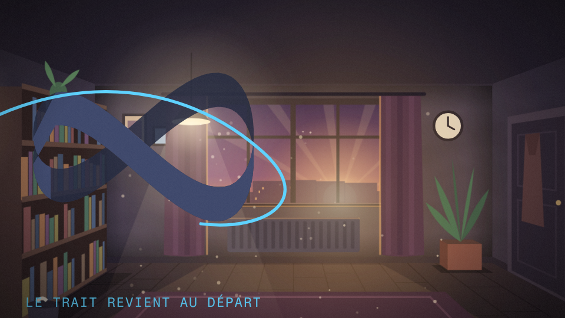
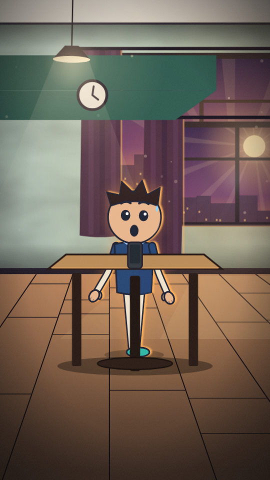
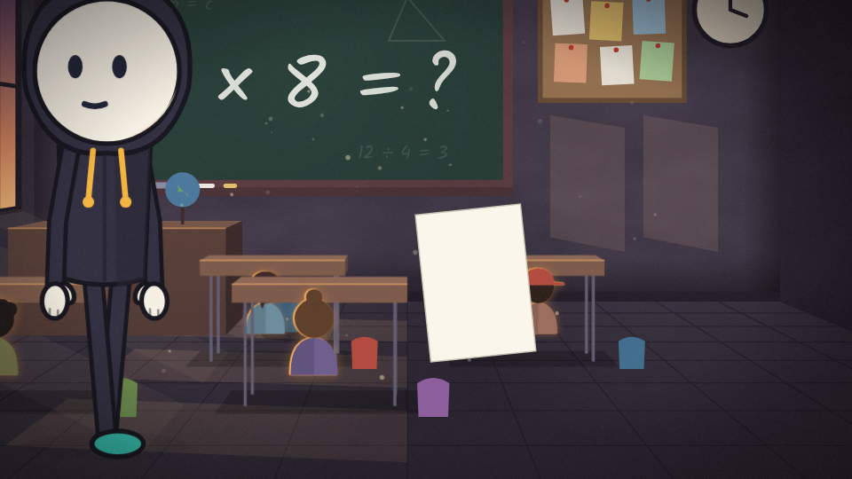
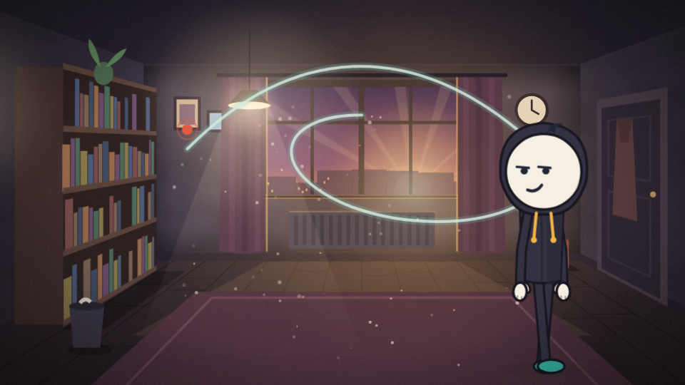
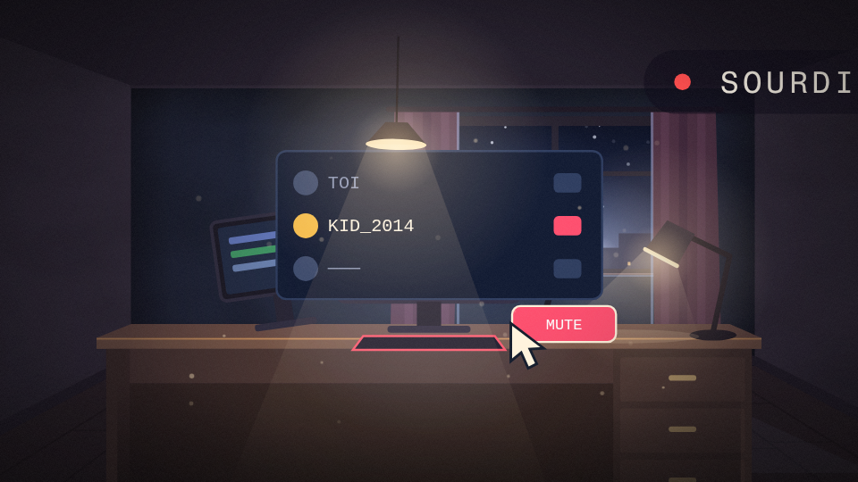
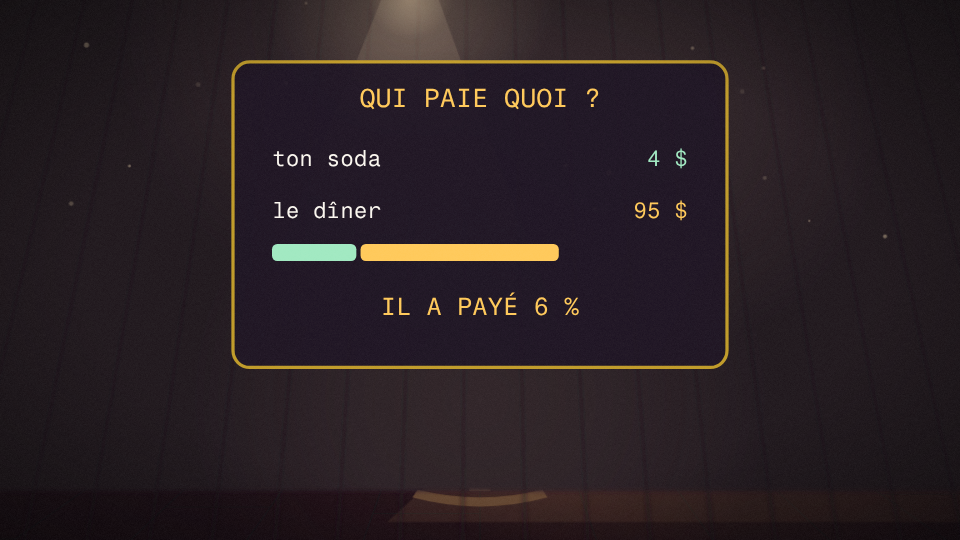
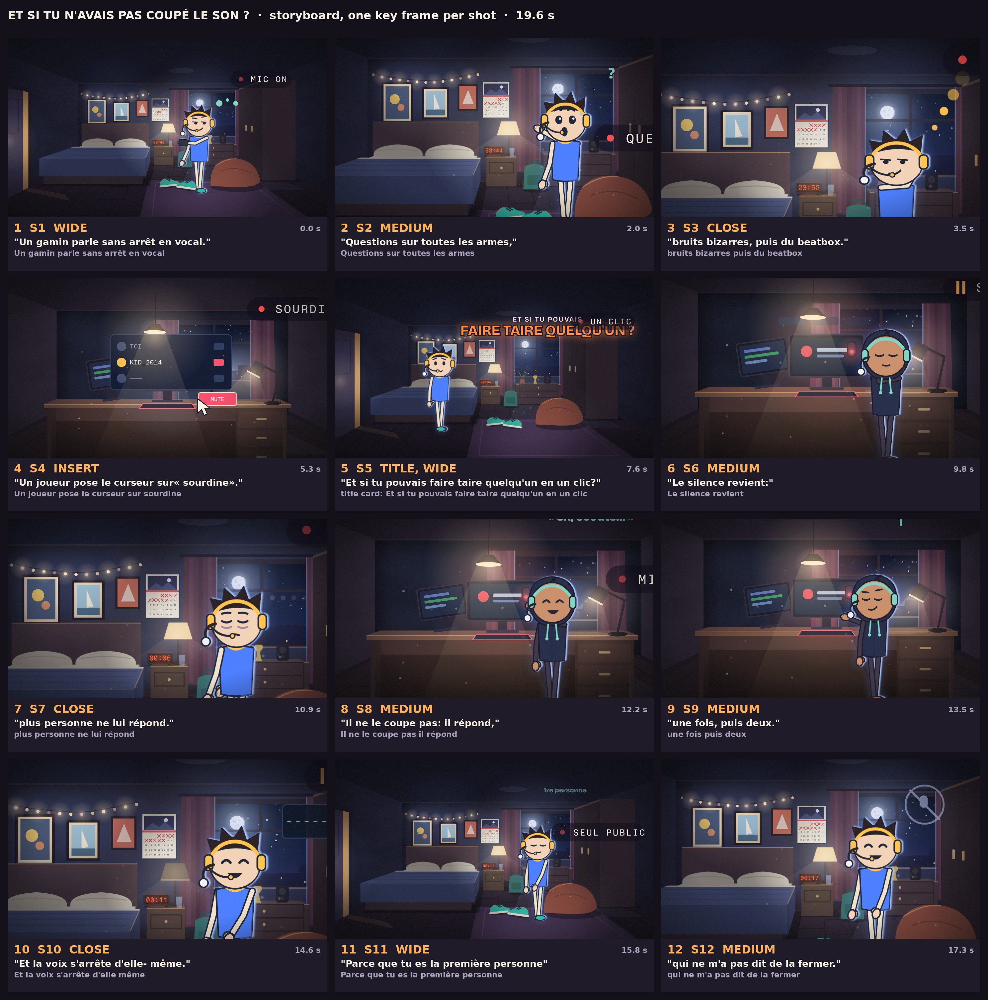
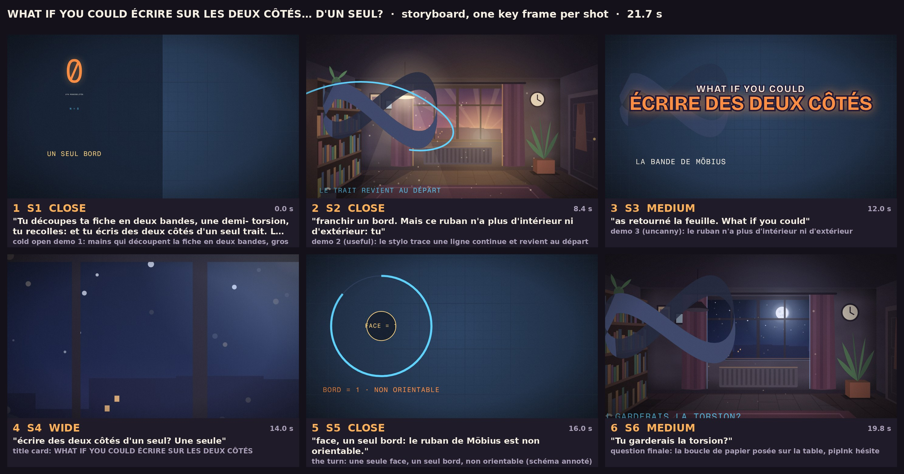
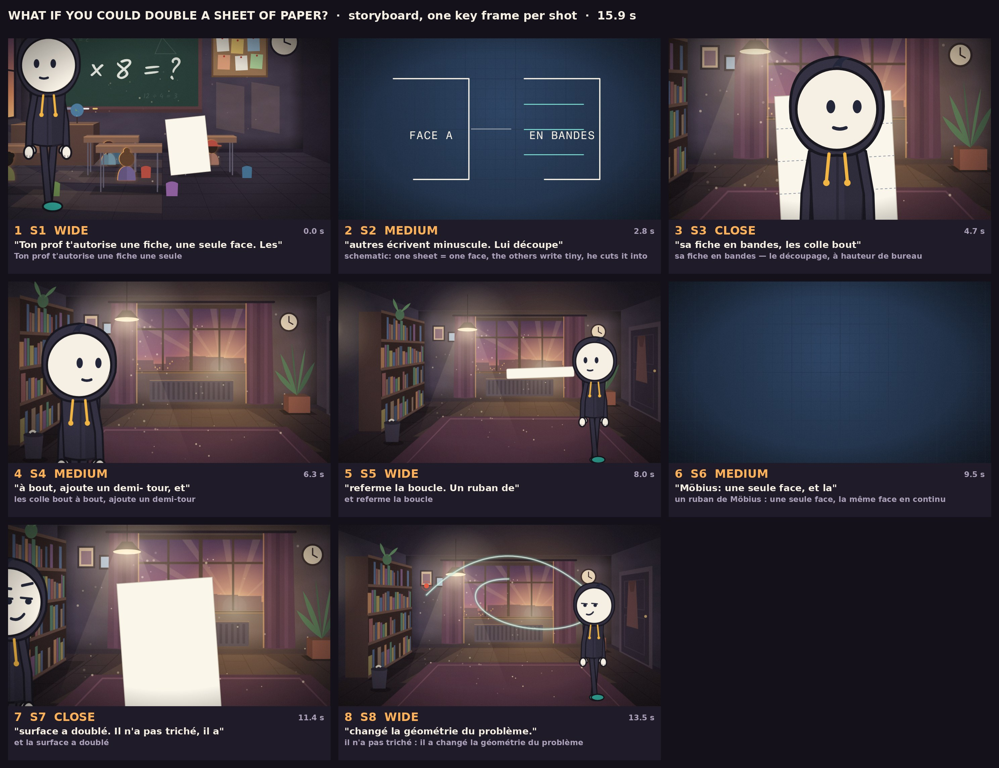
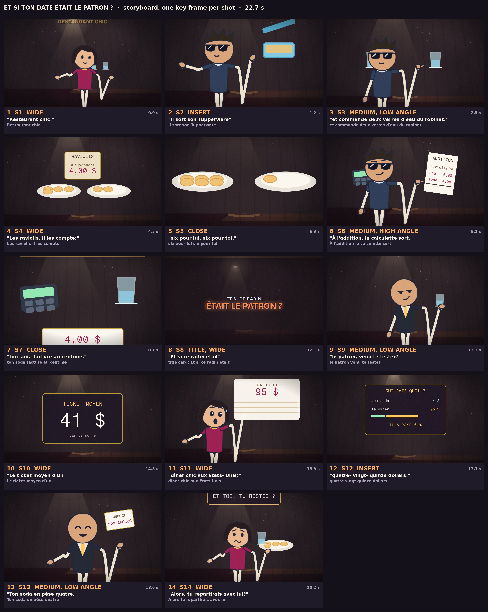

# what-if-app — le studio piloté au chat

Une application web où l'on **parle** à un agent qui fabrique les épisodes *What If* : il lit le dépôt,
écrit le script, lance les scripts du skill (voix ElevenLabs, plan, stills, board, sfx, master), regarde
les images qu'il produit et itère. Le moteur d'animation reste celui du skill `what-if-animation` ;
l'app ajoute ce qui manquait : des **projets**, une **boucle d'agent**, des **outils typés**, des
**portes d'approbation** et des **checkpoints**.

```
navigateur ──► POST /api/threads/:id/messages      (une instruction, en français)
                    │
                    ▼
            orchestrateur  ──►  LLM (n'importe quelle API multimodale)
                    │              │ tool_calls
                    │              ▼
                    │        registre d'outils  ──►  projet (fichiers, git, scripts python)
                    ▼
             SSE ◄── texte, appels d'outils, artefacts, demandes d'approbation
```

## Exemples de productions générées

### Plans HD générés par l'agent (Remotion + moteur 2D)

| *La Bande de Möbius* — ruban continu | *La Bande de Möbius* — carton titre |
| :---: | :---: |
|  |  |
| ***Crush* — salle de classe (discussion)** | ***Crush* — retrait du casque VR** |
|  |  |
| ***Doubler une feuille de papier* — classe** | ***Doubler une feuille de papier* — géométrie** |
|  |  |
| ***Et si tu n'avais pas coupé le son ?* — insert UI** | ***Et si ton date était le patron ?* — schématique** |
|  |  |

### Planches de storyboard automatiques (`whatif_run board`)

Chaque épisode passe par une planche de contact complète (1 image clé par plan + cadrage + timecode + sous-titres alignés au mot près) inspectée par les audits de layout et par l'agent **Reviewer** indépendant avant le rendu vidéo final :

#### *Crush* (`crush` — 36 plans)


#### *Et si tu n'avais pas coupé le son ?* (`almost-muted`)


#### *La Bande de Möbius* (`mobius`)


<details>
<summary>Voir d'autres planches de storyboard (<i>Doubler une feuille de papier</i>, <i>Et si ton date était le patron ?</i>)</summary>

#### *Doubler une feuille de papier* (`math-teacher`)


#### *Et si ton date était le patron ?* (`rdv`)


</details>

## Démarrage

### En local (Node ≥ 22.5)

```bash
npm install
npm run build
WHATIF_PROVIDER=mock npm start       # http://127.0.0.1:3000 — offline, scripté, pour tester la boucle
```

Pour un vrai modèle : ouvre **⚙** dans l'app (fournisseur, base URL, modèle, clé), ou par environnement :

```bash
WHATIF_PROVIDER=openai WHATIF_BASE_URL=https://api.openai.com/v1 \
WHATIF_MODEL=gpt-4.1 WHATIF_API_KEY=sk-… npm start
```

Le skill est détecté automatiquement s'il est juste à côté (`../what-if-animation`) ; sinon
`WHATIF_SKILL_DIR=/chemin/vers/what-if-animation`.

### Sous Docker

```bash
cp .env.example .env          # mets la clé du modèle, puis MODAL_TOKEN_ID / MODAL_TOKEN_SECRET
modal token new               # une fois : écrit ~/.modal.toml (ou passe les deux variables ci-dessus)
docker compose up --build
```

Le conteneur tourne **non-root**, écoute sur `127.0.0.1:3000` seulement, en `network_mode: host` :
l'API locale `nouveau` (:8005, transcriptions, propositions de narration, TTS Fish) écoute elle aussi
sur le `127.0.0.1` de l'hôte, donc un réseau bridge ne la verrait pas. Volumes : `./data` (projets,
SQLite, checkpoints git), `../what-if-animation:/skill:ro` et `~/.modal.toml`.

> **Le rendu ne se fait pas dans ce conteneur.** `whatif_run stills|render` envoie les sources à une
> fonction Modal (`pipeline/modal_render.py`) dont l'image contient déjà Node 24, Chromium, les polices
> et `node_modules` : premier run ≈ 70 s (build de l'image), ensuite ≈ 20 s pour les stills et
> quelques minutes pour une vidéo de 20 s. L'image Docker locale n'a donc pas besoin de Chromium ;
> `WHATIF_RENDER=local` reste une échappatoire (nécessite `whatif_run install` dans le projet).

> **Le TTS passe par `nouveau`.** `whatif_run source` et `whatif_run voice` appellent
> `http://127.0.0.1:8005` (`WHATIF_NOUVEAU_URL` pour changer) : la transcription anglaise (Deepgram), les
> propositions de narration française (conservées intégralement dans `episode.json.script`) et la prise
> **ElevenLabs v4** (`eleven_v4`, vitesse `1.15`, choix automatique de la voix **Léa** ou **Hugo** selon les accords
> grammaticaux du texte) restent attachées au `video_id` d'origine, visibles dans l'UI de `nouveau`. Fish Audio
> reste disponible avec `provider: "fish"`.

## Ce qui existe dans cette v0.1

```
src/tools/           le contrat d'outil et les outils (aucune dépendance runtime)
  types.ts           Tool, ToolResult, validation JSON Schema minimale
  exec.ts            spawn sans shell, argv explicite, timeout, kill
  paths.ts           safeJoin (anti-traversée), walk, glob, extraction de symboles
  fs.ts              repo_map, read_file, write_file, edit_file, glob, grep, view_image
  shell.ts           shell (allowlist), git (status/diff/checkpoint/log/restore)
  shell-policy.ts    la liste blanche des commandes — le vrai rempart
  whatif.ts          whatif_new, whatif_run, whatif_status, whatif_sync_engine + audits statiques
src/orchestrator/
  main.ts            HTTP + routes + SSE + fichiers (Range pour la vidéo) + auth par token + minuteur
  agent.ts           la boucle : modèle → outils → résultats → reviewer → modèle, checkpoint avant mutation
  context.ts         compilation du contexte : prompt système, épinglage de continuité (DIRECTOR.md, bible.json, en-tête shots.tsx), historique compacté
  reviewer.ts        agent Reviewer indépendant (contexte vierge) après l'étape board -> out/<slug>/review.json
  approvals.ts       porte "ask" : le run se bloque jusqu'au clic, timeout = refus
  db.ts              SQLite (node:sqlite) : projets, fils, messages, approbations, crédits, durées d'exécution
  bus.ts             bus d'événements par fil + buffer de rejeu (le SSE survit à un reload)
  providers/         openai-compatible (streaming + tool calls + vision), anthropic, mock
web/public/          l'UI : chat, minuteur temps réel, cartes d'outils, images/vidéos, approbations, réglages
test/                smoke tests (outils, allowlist, audits, compaction, reviewer, boucle complète HTTP)
```

Zéro dépendance runtime : `node:http`, `node:sqlite`, `fetch` natif. Seul TypeScript est en dev.

## Les outils

| outil | politique | à quoi ça sert |
|---|---|---|
| `repo_map` | auto | arborescence + symboles exportés, sans `node_modules/out/.git` |
| `read_file` / `edit_file` / `write_file` | auto | lecture avec numéros de ligne ; remplacement ciblé (oldText unique, échec explicite) |
| `glob` / `grep` | auto | chercher un fichier, chercher du texte |
| `view_image` | auto | rattache une still / planche / grille pour que le modèle la voie |
| `shell` | ask (non bloquant par défaut) | une seule commande, dans une allowlist (`npx tsc`, `npx remotion`, `python scripts/…`, `ffmpeg`, `git`…) |
| `git` | auto | statut, diff, checkpoint, log, restore |
| `whatif_new` | ask (non bloquant par défaut) | copie le studio du skill + squelette d'épisode (`episode.json`, `timeline.json`, `shots.tsx`, `index.tsx`), enregistré dans `src/episodes/index.ts` |
| `whatif_run` | ask (non bloquant par défaut) | une étape du pipeline : `install, source, voice, plan, stills, board, sfx, mixcheck, motiongrid, render, master` |
| `whatif_status` | auto | où en est l'épisode (script, words, timeline, stills, board, sfx, render, report) |
| `whatif_sync_engine` | ask (non bloquant par défaut) | compare `src/engine` au skill, liste les fichiers modifiés localement, n'écrase que sur `apply` |

Trois politiques par outil : `auto` (l'agent agit), `ask` (soumis à la porte d'approbation), `deny`
(l'outil disparaît du contexte).

**Par défaut l'agent ne demande rien** (`WHATIF_APPROVALS=off`) : il enchaîne source → script → voice →
plan → stills → board → render → master dans le même tour et te rend le mp4 final (`sfx`, `mixcheck` et
`motiongrid` sont optionnels : une clé ElevenLabs invalide ne doit pas arrêter la chaîne). `pipeline`
rétablit une validation avant chaque outil qui modifie un projet, `all` avant tout outil `ask`.

Ce qui rend un tour non surveillé tenable, et qui se règle :

| variable | défaut | rôle |
| --- | --- | --- |
| `WHATIF_APPROVALS` | `off` | `off`, `pipeline` ou `all` |
| `WHATIF_MAX_STEPS` | `1000` | appels modèle par tour |
| `WHATIF_MAX_TOKENS` | `24000` | budget de sortie ; les modèles de raisonnement/Flash y pensent d'abord |
| `WHATIF_CONTEXT_CHARS` | `90000` | au-delà, les vieux résultats d'outils sont compactés (tandis que `DIRECTOR.md`, `bible.json` et l'en-tête de `shots.tsx` restent épinglés) |
| `WHATIF_REVIEWER_ENABLED` | `true` | active un second agent Reviewer indépendant au contexte vierge après `board` |
| `WHATIF_REVIEW_MODEL` | *(hérite)* | modèle du Reviewer (ex: un modèle vision rapide comme `google/gemini-2.5-flash`) |
| `WHATIF_REVIEW_MAX_ROUNDS` | `2` | tours max de correction demandés par le Reviewer par épisode |

Le prompt système porte l'ordre du pipeline, le budget de mots (50-60 pour 15-25 s), la grammaire des
cues `episode.json` (`f:120`, `s:4.2`, `S1+2`, `franchir+3` — **pas** de `w:`), et la liste générée de
tous les exports de `src/engine` avec leurs props : l'agent n'a pas à lire 4 500 lignes de TSX pour
écrire un shot. Les outils vérifient les pré-requis (un `stills` sans `words.json` est refusé), le plan
qui s'effondre en un seul segment est signalé avec des ancres valides, et chaque still est mesuré
(zone d'encre) pour dire « la moitié droite est vide » plutôt que de laisser passer une image vide.

Toute mutation prend de toute façon un **checkpoint git** avant de s'exécuter : `git log` rejoue
l'histoire de l'épisode, `git restore` revient en arrière. Le bouton **Stop** interrompt un tour en
cours.

## Les plans

Le squelette d'un épisode n'a **qu'un seul plan**, celui du gabarit : c'est ce qui donnait une planche
d'un personnage dans une cuisine sans rapport avec le script. Deux garde-fous :

- `whatif_run shotlist` découpe les mots mesurés en **6 à 12 plans** (une coupe toutes les 1,9 s, comme
  les épisodes de référence : 17 segments pour 560 frames). Chaque plan reçoit un décor déduit du vocabulaire
  de son passage (`prof`, `classe` → classroom ; `face`, `bord`, `surface` → schematic), une taille, un
  nombre de keyframes, et une note faite des mots qu'il couvre. `plan` le lance tout seul si la liste est
  encore celle du gabarit.
- `stills` refuse de rendre un plan encore marqué `placeholder`, et mesure chaque image (zone d'encre,
  `src/orchestrator/layout.ts`) : un plan vide ou écrasé dans un tiers de la frame fait échouer l'étape
  avec le nom du plan, au lieu de partir dans la vidéo.

Les décors sont fixes (study, kitchen, classroom, stairwell, rooftop, bedroom, schematic) comme le
casting : l'agent écrit `S1..Sn` dans `shots.tsx`, un composant par plan, chacun fonction pure de son
propre temps.

## Le cycle d'un épisode

0. **Créer** : le bouton `+` de la colonne Projets demande le nom, le slug de l'épisode et un
   `video_id` `nouveau`. Si la case « Lancer l'agent » est cochée, l'app crée le fil, y poste la
   consigne et l'agent enchaîne import de la source puis écriture du script — chaque étape sensible
   passe par ta validation. `/#nouveau` ouvre directement ce formulaire.

1. **Source** : la plupart du temps tu ne donnes qu'un `video_id` (YouTube ou TikTok, déjà dans
   `nouveau`). `whatif_new { video }` crée le projet avec cette source, `whatif_run source`
   transcrit (anglais, Deepgram), demande deux propositions de **narration française**, garde celle que
   tu choisis dans `out/<slug>/source.fr.md` et remplit `episode.json`. L'agent relit ce fichier et
   écrit lui-même un script de 15–25 s : une condensation, pas une traduction.
2. **Script** : l'agent remplit `episode.json` (cold open en 3 démos, prémisse, coût avec un fait sourcé).
3. **`voice`** → Fish Audio via `nouveau`, même `video_id` : `public/<slug>/voice.wav` + `words.json`.
   Fish ne rend pas d'horodatage, donc la prise est retranscrite (Deepgram) puis réalignée sur
   l'orthographe du script. Débit mesuré : **~3,4 mots/s** (`speakingRate` 1), donc 15–25 s = **50 à
   60 mots**. `--model` / `WHATIF_NARRATION_MODEL` choisit le modèle qui écrit les propositions de
   `nouveau` : son défaut peut être un nom absent du compte (« Aucune proposition générée »). **`plan`** → `timeline.json` (segments, shots, fx, audio).
4. **`stills`** (sur Modal) puis **`board`** : l'agent regarde la planche (`view_image`) et te demande l'accord.
5. **Après accord seulement** : `sfx` (ElevenLabs), `mixcheck`, `render` (Modal, sans audio ajouté : le
   son vient des `<Audio>` de la composition), `master` → `master.py --skip-render`
   (−14 LUFS, crêtes < −1 dBTP, `report.json`).
6. Il tient `PROJECT.md` à jour : décisions, sources, ce qui est approuvé. C'est sa mémoire entre deux
   sessions, et ton point de reprise.

Le contexte est recompilé à chaque étape (prompt + PROJECT.md + arborescence + historique) et compacté
quand il dépasse `WHATIF_CONTEXT_CHARS` : les vieux résultats d'outils sont tronqués, le début de
conversation est résumé, les images récentes sont rattachées (max 3 par tour, ~4,5 Mo).

## Mettre à jour le moteur sans perdre son travail

`src/engine` appartient au skill, pas à l'app. La mise à jour est donc explicite :

```
whatif_sync_engine                 # rapport : nouveaux fichiers / identiques / modifiés localement
whatif_sync_engine { apply: true } # écrase après checkpoint git
```

Tu vois donc toujours *ce que tu as changé* avant de le perdre, et `git restore` annule.

## Tests

```bash
npm test        # build + 3 tests : outils, allowlist shell, boucle agent complète en HTTP (mock)
bash scripts/demo.sh "fais un tour du projet"   # contre un serveur déjà lancé
```

## Dépannage

**La page ne s'affiche pas / le conteneur redémarre en boucle**

```bash
docker compose ps            # STATUS: Restarting → il crashe
docker compose logs --tail=30
```

Si tu vois `Error: unable to open database file`, c'est `/data` : quand Docker crée le dossier
`./data` du bind mount, il le possède en `root:root` et l'app (uid 1000) ne peut pas y écrire SQLite.
L'entrypoint corrige maintenant le propriétaire puis abandonne les privilèges (`setpriv`), donc un
`docker compose up -d --build` suffit. Si ton dossier est sur un montage réseau ou en lecture seule,
utilise plutôt un volume nommé :

```yaml
    volumes:
      - whatif-data:/data
volumes:
  whatif-data:
```

**`warning: no studio/ in /skill`**

Le skill n'est pas monté : vérifie `WHATIF_SKILL_DIR` et le volume `../what-if-animation:/skill:ro`.

**Le modèle répond mais n'appelle jamais d'outil**

Certaines passerelles « openai-compatible » ignorent `tools`. Teste avec un modèle qui sait faire du
tool calling ; sinon l'agent discute mais ne touche pas au projet.

**`npx remotion render` échoue dans le conteneur**

Pas de GPU et pas de sandbox dans Docker : il faut `--gl=swangle` et `--no-sandbox` (Chromium headless),
et `shm_size: "1gb"` côté compose.

## Sécurité — à lire

- Le shell est une **RCE par conception** : l'agent écrit et exécute du code dans le projet. L'allowlist
  bloque les opérateurs (`; | & > $ ( )`) et les binaires non listés, mais ce n'est pas un bac à sable.
  Fais tourner l'app dans le conteneur, sur `127.0.0.1`, avec `WHATIF_AUTH_TOKEN` si autre chose que
  ta machine peut l'atteindre.
- Les clés sont stockées dans SQLite (`data/app.db`) et ne sont jamais renvoyées au navigateur
  (`hasKey` seulement). Pour un déploiement partagé, préfère les variables d'environnement et un
  utilisateur par conteneur.
- Chaque projet vit dans `data/projects/<id>` ; `safeJoin` refuse toute sortie de ce dossier.

## Prochaines étapes (dans l'ordre)

1. **CLI + serveur MCP** au-dessus du même registre : `whatif run "…"`, et l'agent utilisable depuis
   Claude Code / OpenCode. Le registre est déjà indépendant de l'HTTP.
2. **Budgets** : plafond de crédits par projet et par tour, refus automatique au-delà (`ledger` existe).
3. **Planches de trames** : attacher automatiquement `motiongrid` au contexte, et un outil `compare_frames`
   pour juger le mouvement — c'est là que la qualité se joue.
4. **Multi-utilisateur** : sessions, un token par personne, un `data/projects/<user>` par compte.
5. **Reprise de run** : persister l'état de la boucle pour survivre à un redémarrage du conteneur.

## Licence

Le moteur et les scripts viennent du skill `what-if-animation` (voir sa LICENSE). Cette app est un
harnais : elle n'embarque ni les polices, ni les assets, ni les voix.
